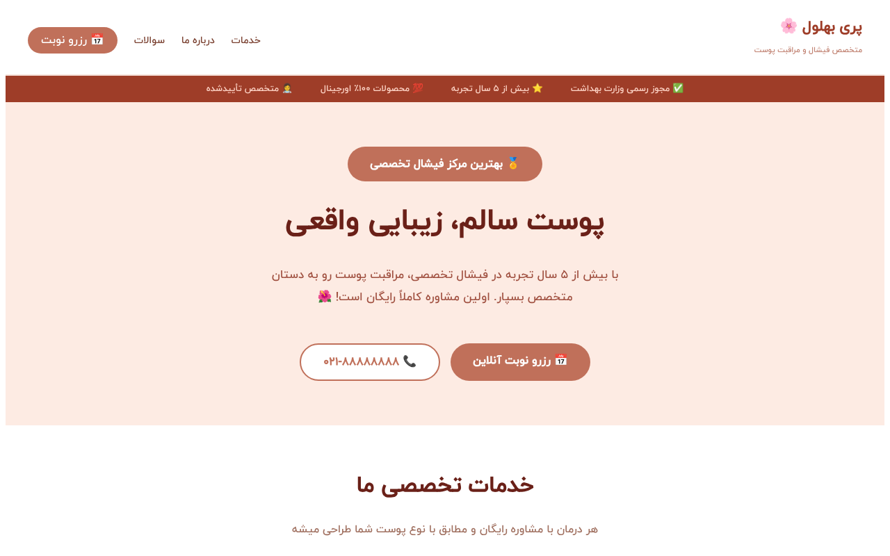

<div dir="rtl" align="right">

<div align="center">

# 🌸 وب‌سایت رزرو فیشال

**وب‌سایت ریسپانسیو فارسی برای متخصص فیشال و مراقبت پوست، با امکان درخواست نوبت آنلاین**

[](LICENSE)

[English](README.md)



</div>

---

## درباره پروژه

یک وب‌سایت تک‌صفحه‌ای که متخصص پوست را معرفی می‌کند، خدمات فیشال را نشان می‌دهد، به سوالات متداول پاسخ می‌دهد و به بازدیدکننده اجازه می‌دهد آنلاین درخواست نوبت بدهد. درخواست‌ها با EmailJS مستقیم به ایمیل صاحب سایت می‌رسند، پس پروژه به بک‌اند جداگانه نیاز ندارد.

## امکانات

- بخش معرفی (Hero) با نشان‌های اعتماد و دکمه‌های تماس و رزرو
- بخش خدمات با کارت‌های درمان و قیمت
- بخش درباره‌ی متخصص و مدارک
- سوالات متداول به‌صورت آکاردئون
- فرم رزرو آنلاین (نام، موبایل، توضیحات) که درخواست را ایمیل می‌کند
- اسکرول نرم بین بخش‌ها
- طراحی ریسپانسیو برای موبایل، تبلت و دسکتاپ
- فونت فارسی ایران‌یکان

## تکنولوژی‌ها

React 19 · Vite · React Icons · EmailJS · CSS · ESLint

## نصب و اجرا

پیش‌نیاز: Node.js نسخه‌ی ۲۰ یا بالاتر.

</div>

```bash
git clone https://github.com/ashirzadian3-prog/facial-booking-website.git
cd facial-booking-website/Tamrin
npm install
npm run dev
```

<div dir="rtl" align="right">

برنامه روی `http://localhost:5173` اجرا می‌شود.

### تنظیم EmailJS (اختیاری)

برای اینکه درخواست‌ها به ایمیل خودتان برسند:

1. در [emailjs.com](https://www.emailjs.com/) حساب رایگان بسازید.
2. یک Email Service اضافه کنید و Service ID را بردارید.
3. یک Email Template بسازید که از متغیرهای `{{from_name}}`، `{{phone}}` و `{{message}}` استفاده کند و Template ID را بردارید.
4. Public Key را از صفحه‌ی Account کپی کنید.
5. فایل `.env.example` را به `.env` کپی کنید و سه مقدار را وارد کنید.

> شناسه‌های EmailJS ذاتاً عمومی هستند، چون داخل فایل نهایی مرورگر قرار می‌گیرند. هیچ کلید خصوصی‌ای را در متغیرهای `VITE_` نگذارید و فایل `.env` را commit نکنید.

## اسکریپت‌ها

| دستور             | کار                          |
| ----------------- | ---------------------------- |
| `npm run dev`     | اجرای سرور توسعه             |
| `npm run build`   | ساخت نسخه‌ی نهایی            |
| `npm run preview` | پیش‌نمایش نسخه‌ی نهایی       |
| `npm run lint`    | بررسی کد با ESLint           |

## مشارکت

قبل از ارسال Pull Request فایل [CONTRIBUTING.md](CONTRIBUTING.md) را بخوانید.

## لایسنس

این پروژه با لایسنس MIT منتشر شده است. جزئیات در [LICENSE](LICENSE).

## سازنده

**A Shirzadian** — [@ashirzadian3-prog](https://github.com/ashirzadian3-prog)

</div>
