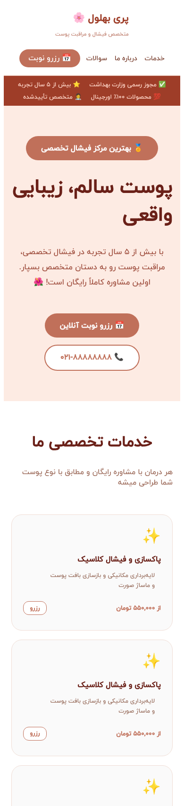
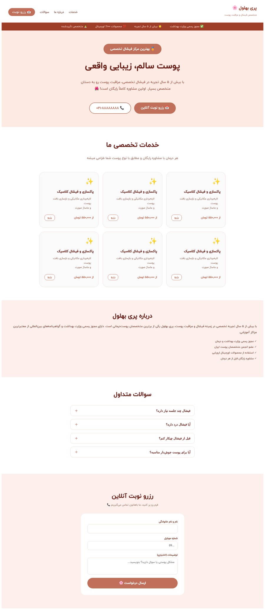

<div align="center">

# 🌸 Facial Booking Website

**A responsive Persian (RTL) website for a facial and skin-care specialist, with online appointment requests.**

[](https://github.com/ashirzadian3-prog/facial-booking-website/actions/workflows/ci.yml)
[](LICENSE)


[**فارسی**](README.fa.md) · [Report a Bug](../../issues/new?template=bug_report.md) · [Request a Feature](../../issues/new?template=feature_request.md)


</div>

---

## Table of Contents

- [About](#about)
- [Features](#features)
- [Tech Stack](#tech-stack)
- [Getting Started](#getting-started)
- [EmailJS Setup](#emailjs-setup)
- [Available Scripts](#available-scripts)
- [Project Structure](#project-structure)
- [Deployment](#deployment)
- [Roadmap](#roadmap)
- [Contributing](#contributing)
- [License](#license)
- [Author](#author)

## About

A single-page website that introduces a skin-care specialist, lists her facial treatments, answers common questions and lets visitors request an appointment online. Requests are delivered straight to the owner's inbox through EmailJS, so the project needs no backend of its own.

The interface is written in Persian and works on desktop, tablet and mobile.

<details>
<summary><b>Mobile and full-page preview</b></summary>
<br>

<br><br>

</details>

## Features

- **Hero section** with trust badges and one-tap call and booking buttons
- **Services section** with treatment cards and prices
- **About section** presenting the specialist and her credentials
- **FAQ accordion** answering common questions about facials
- **Online booking form** (name, phone, notes) that emails the request via EmailJS
- **Smooth scrolling** navigation between sections
- **Responsive layout** for phones, tablets and desktops
- **Persian typography** with the IRANYekan font

## Tech Stack

| Area      | Technology                                          |
| --------- | --------------------------------------------------- |
| UI        | [React 19](https://react.dev/)                      |
| Build     | [Vite](https://vite.dev/)                           |
| Icons     | [React Icons](https://react-icons.github.io/react-icons/) |
| Email     | [EmailJS](https://www.emailjs.com/)                 |
| Styling   | Plain CSS, one stylesheet per component             |
| Linting   | [ESLint](https://eslint.org/)                       |

## Getting Started

### Prerequisites

- [Node.js](https://nodejs.org/) 20 or newer
- npm (bundled with Node.js)

### Installation

```bash
# 1. Clone the repository
git clone https://github.com/ashirzadian3-prog/facial-booking-website.git
cd facial-booking-website/Tamrin

# 2. Install dependencies
npm install

# 3. Start the dev server
npm run dev
```

The app will be available at `http://localhost:5173`.

### Environment Variables (optional)

The booking form ships with working default EmailJS settings. To receive requests in your own inbox, copy `.env.example` to `.env` and fill in your values:

| Variable                   | Description                    |
| -------------------------- | ------------------------------ |
| `VITE_EMAILJS_SERVICE_ID`  | Your EmailJS service ID        |
| `VITE_EMAILJS_TEMPLATE_ID` | Your EmailJS template ID       |
| `VITE_EMAILJS_PUBLIC_KEY`  | Your EmailJS public key        |

> EmailJS identifiers are public by design because they ship in the browser bundle. Never put a private key in a `VITE_` variable. Never commit your `.env` file (it is already in `.gitignore`).

## EmailJS Setup

1. Create a free account at [emailjs.com](https://www.emailjs.com/).
2. Add an **Email Service** and note its Service ID.
3. Create an **Email Template** that uses these variables: `{{from_name}}`, `{{phone}}` and `{{message}}`. Note its Template ID.
4. Copy your **Public Key** from the Account page.
5. Put the three values into `.env` as shown above.

## Available Scripts

Run these from the `Tamrin/` directory:

| Command           | Description                            |
| ----------------- | -------------------------------------- |
| `npm run dev`     | Start the development server           |
| `npm run build`   | Create an optimized production build   |
| `npm run preview` | Preview the production build locally   |
| `npm run lint`    | Lint the source code with ESLint       |

## Project Structure

```text
facial-booking-website/
├── .github/                 # CI workflow, issue and PR templates
├── docs/
│   └── images/              # README screenshots
└── Tamrin/                  # The React application
    ├── public/
    └── src/
        ├── App/             # App shell, hero section (Homefirst) and Home layout
        ├── Navbar/          # Top navigation
        ├── Navbarbottom/    # Trust badges bar
        ├── Service/         # Services cards
        ├── Aboutus/         # About the specialist
        ├── Questions/       # FAQ accordion
        ├── Reserve/         # Booking form (EmailJS)
        ├── fonts/           # IRANYekan font files
        ├── responsive.css   # Tablet and mobile overrides
        └── main.jsx         # Entry point
```

## Deployment

Any static host works (Vercel, Netlify, GitHub Pages). On Vercel or Netlify:

1. Import the repository.
2. Set the **Root Directory** to `Tamrin`.
3. Use build command `npm run build` and output directory `dist` (detected automatically for Vite).
4. Optionally add the three `VITE_EMAILJS_*` environment variables.

A [`vercel.json`](Tamrin/vercel.json) is included so deep links keep working.

## Roadmap

- [ ] Replace the placeholder service cards with the real treatments and prices
- [ ] Let visitors choose a service and preferred date and time in the form
- [ ] Inline form validation instead of `alert()` messages
- [ ] Phone number format validation
- [ ] Image gallery with before and after results
- [ ] SEO improvements and an Open Graph preview image
- [ ] Accessibility pass (focus states, ARIA for the FAQ accordion)

Have an idea? [Open an issue](../../issues/new?template=feature_request.md).

## Contributing

Contributions, issues and feature requests are welcome. Please read [CONTRIBUTING.md](CONTRIBUTING.md) first.

## License

Distributed under the MIT License. See [LICENSE](LICENSE) for details.

## Author

**A Shirzadian**

- GitHub: [@ashirzadian3-prog](https://github.com/ashirzadian3-prog)

If you like this project, consider giving it a ⭐
